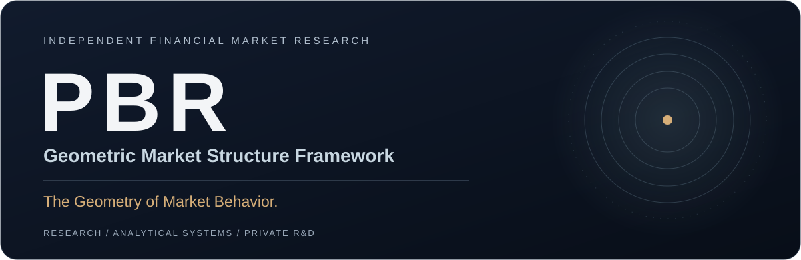

 

**An independent research initiative exploring financial market behavior through a geometric perspective.**

*Market research · Analytical instruments · Systematic evaluation*

 

## Why PBR Exists

Financial markets generate a continuous record of movement, yet interpreting that record remains a difficult research problem. A visual observation can suggest an interesting relationship without establishing whether that relationship is consistent, measurable, or useful under changing market conditions.

PBR was conceived around the study of market behavior. Its development brings together an original analytical methodology and subsequent mathematical and software research, with the goal of creating instruments that can be examined with discipline.

> **An analytical idea deserves careful development and evidence before it becomes a claim about the market.**

 

# The PBR Idea

PBR — **Geometric Market Structure Framework** — is an independent financial-market research and development initiative. Its identity is grounded in a geometric perspective on market behavior, with a commitment to rigorous analytical development and systematic evaluation.

Its intended scope spans financial-market research and specialized analytical instruments. It is not presented as an investment product, a proven trading system, or a promise of predictive accuracy.

 

# Research Direction

| Area | Research intent |
|---|---|
| **Financial market behavior** | Investigate the ways market activity can be understood and described. |
| **Analytical instruments** | Develop research tools suited to disciplined observation and investigation. |
| **Systematic evaluation** | Examine hypotheses and distinguish observations from validated results. |
| **Responsible development** | Preserve research integrity, provenance and appropriate limitations. |

These are broad research directions, not a specification of the underlying methodology or a list of delivered capabilities.

 

# Origins & Contributions

The original PBR methodology and its initial graphical form were developed by **رامین کحالزاده**. Subsequent mathematical formalization, original methodological extensions, software architecture and instrument development are attributed to **[Ali Alavi](https://github.com/alaviarts)**.

The project recognizes the distinct intellectual contributions of both individuals. This acknowledgement records creative provenance; it does not establish ownership shares, licensing authority or commercial terms.

 

# Independent Project Identity

PBR is a distinct research initiative with its own origins and intellectual-property boundaries. It is independent of other financial-market products, including iGold. No present integration, shared ownership or technical dependency is implied.

 

## Current Status

**Private Research & Development**

PBR is evolving through research, design and development. Public information is intentionally limited to project identity, general research direction, and attribution. No release date, availability, performance claim or investment outcome is announced.

<strong>Public Scope & Intellectual Property</strong>

 

This repository is the public presentation of PBR. It is not an open-source distribution and does not include proprietary source code, methods, internal design documents, or research data. All applicable rights remain reserved by their respective rights holders. See [Proprietary Rights Notice](./LICENSE.md) and [Attribution Notice](./NOTICE.md).

 

---

**PBR**

Original methodology · رامین کحالزاده

Mathematical formalization, methodological extensions &amp; software architecture · [Ali Alavi](https://github.com/alaviarts)

 

All applicable rights reserved by their respective rights holders.

[Proprietary Rights Notice](./LICENSE.md) · [Attribution Notice](./NOTICE.md)

*The Geometry of Market Behavior.*

